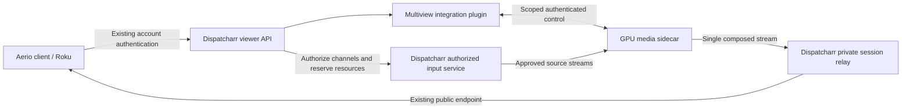

# Interactive multiview delivery plan

Parent epic: `AerioTV-Roku-cba`.
Research: `AerioTV-Roku-cba.1`, [source findings](MULTIVIEW-SIDECAR-RESEARCH.md).
Status: PO authorized backlog creation, 2026-09-26 UTC. Delivery is tracked in
`AerioTV-Roku-cba.2` through `AerioTV-Roku-cba.30`; explicit product decisions and
Dispatcharr maintainer agreement remain pending.

## 1. Goal and agreed scope

Deliver an Aerio-controlled multiview session with 2–4 live panels. The viewer
can assign/switch channels, choose layout presets, adjust split ratios, and move
focus to select the sole audible panel. Roku plays one composed live stream.

Both playback and viewer controls use the existing public Dispatcharr endpoint.
The media sidecar stays on the internal network. Sources are Dispatcharr API
accounts or Dispatcharr-provided M3U/XC connections, subject to the same viewer
permissions and active profile as ordinary Aerio playback.

The server administrator installs a lightweight plugin and minimal media
container, configures the internal sidecar host/port and GPU access, and receives
connection/capability status. Credential provisioning should be automatic after
deployment establishes initial trust. Viewers reuse their Aerio connection.

Required acceleration paths are Intel VAAPI, Intel QSV, NVIDIA and AMD VAAPI.
Capability reporting distinguishes hardware decoding, composition and encoding.
Normal Live TV remains the fallback when multiview is unavailable.

## 2. Architecture and ownership

The viewer API, private session relay and resource-grant interfaces in this
diagram are proposed additions, not existing Dispatcharr features.

| Owner/component | Responsibilities |
|---|---|
| Dispatcharr core/extension | Trusted viewer identity, channel authorization, supported plugin routing, input reservations/client ownership and authorized output relay. |
| Integration plugin | Admin setup, sidecar enrollment, protocol negotiation, capability discovery and translating authorized viewer operations into scoped sidecar requests. |
| Sidecar | Media session state, admission against host budgets, input supervision, GPU selection, composition, audio selection and output continuity. |
| Aerio | Discover capability, present layouts/channel selection, send revisioned changes, play the Dispatcharr URL and reconcile requested/applied state. |

Dispatcharr owns authorization and playback grants. The sidecar owns applied
media state. Aerio requests changes; it does not invent an authoritative account
scope. Dispatcharr's broker maintains the durable ownership/session mapping
across its web workers. Each session has one media owner to avoid duplicate
workers during retries or restarts.

## 3. What we need from Dispatcharr's developers

We can offer to implement and contribute patches. What we need first is agreement
on supported integration points, followed by review and a release containing
those interfaces. We should not assume the maintainers will build the sidecar
or accept a specific API design before discussion.

### A. A supported viewer-facing plugin API surface — required

**Current gap:** standard plugin POST actions are admin-only and plugin action
context does not carry authenticated caller identity.

**Request:** provide either a narrowly scoped multiview API or a supported
viewer-extension route mechanism that:
- Mounts under Dispatcharr's existing public origin and base path.
- Passes trusted user, authentication scope and request context to the handler.
- Allows explicit per-operation permission checks for ordinary streaming users.
- Respects network restrictions without requiring remote access to the admin UI.
- Supports bounded request/response bodies, API versioning, disabled-plugin
  behavior and reload-safe registration across web workers.
- Keeps plugin installation, settings and arbitrary administrative actions
  restricted to administrators.

**Acceptance:** a non-admin viewer can discover multiview and create/update/stop
their own session, but cannot change plugin settings or another viewer's state.
Agree whether this is a generic extension interface or a dedicated integration;
we need the behavior, not a predetermined core implementation.

### B. Reusable viewer and channel authorization — required

**Current gap:** API, XC and anonymous M3U surfaces have different authentication
semantics; internal model/proxy access does not automatically inherit a lineup's
permission checks.

**Request:** a supported identity/authorization service that:
- Resolves API keys and XC credentials using Dispatcharr's current rules.
- Checks active account status, allowed network surface and current grants.
- Resolves allowed channels/profile memberships and enforces a selected profile
  as a narrowing constraint.
- Provides a defined M3U bootstrap policy: account-bearing URL/token or an
  explicitly configured guest/device scope.
- Supports short-lived session grants and revocation/permission revalidation.
- Lets the plugin delegate narrowly scoped input access without forwarding
  reusable viewer/admin credentials to the sidecar.

**Acceptance:** channel access matches the permitted viewer lineup; account
revocation and profile changes invalidate access within an agreed bound. XC-only
streaming users can use multiview without a separate dashboard/API-key login.

### C. Private session playback through Dispatcharr — required

**Current gap:** registering a normal composite channel does not provide private
session ownership. The ordinary live-proxy route is not a session-owner boundary.

**Request:** a supported authorized session-output relay, or equivalent extension
hook, with:
- A playback grant bound to a session and viewer/device scope.
- Internal source registration restricted to the trusted plugin/sidecar.
- Byte relay through Dispatcharr rather than redirects to an internal URL.
- A stable public playback address and bounded reconnect/expiry behavior.
- No default publication in the global M3U/XC lineup.
- Stats/lifecycle integration and no unnecessary second video encode.
- Origin-safe playlist/segment/key handling if HLS is later selected.

**Acceptance:** a WAN Roku plays the composite using Dispatcharr alone, while a
different viewer cannot play the session by obtaining its ID. Expired grants,
disabled plugins and stopped sessions cannot continue opening new playback.

### D. Non-destructive input admission and lifecycle — required

**Current gap:** stream-limit enforcement can terminate an existing connection;
the existing Multiview plugin registers its inputs without a viewer identity.

**Request:** a supported reserve/open/release interface, or equivalent core
extension, that:
- Admits the complete requested input set or reports insufficient capacity.
- Rejects excess multiview work instead of evicting another viewer's stream.
- Preserves provider/profile capacity limits and authorized source sharing.
- Associates input clients with the owning viewer and composite session.
- Rolls back partial opens and releases only owned clients.
- Defines viewer-limit accounting for inputs versus the single composite output.
- Handles renewal, expiry, crash reconciliation and temporary channel-switch
  overlap without oversubscription.

**Acceptance:** at capacity, a failed multiview request leaves other playback
unchanged; Stop/expiry returns reservations and clients to baseline, including
after partially failed creation.

### E. Compatibility, lifecycle and distribution agreement — required for release

Ask maintainers to confirm:
- The supported minimum Dispatcharr version and extension compatibility policy.
- Reload/disable/startup semantics across multiple application workers.
- Which internal proxy/statistics services can be depended on, and how we should
  expose multiview-specific metadata without bypassing accounting.
- An integration-test fixture covering admin, ordinary API and XC-only users.
- Preferred upstream contribution process and whether they favor extending the
  existing Multiview plugin, a new integration plugin, or a reusable core API.

Public Plugin Registry submission follows a stable release; it is a distribution
step, not a prerequisite for developing and validating the integration.

## 4. Proposed session and trust contract

### Viewer flow

1. Aerio discovers multiview support and the plugin/sidecar protocol versions
   through its configured Dispatcharr origin.
2. Dispatcharr authenticates the existing account and returns scoped capabilities
   and permitted channel identifiers. Anonymous M3U follows the agreed policy.
3. Aerio submits a session request: panel IDs/channel IDs, preset, split ratios,
   focused/audio panel and a supported output profile.
4. Dispatcharr checks entitlements and reserves input capacity. The sidecar
   separately admits the required host/GPU resources.
5. The broker opens the session using short-lived internal grants. Partial
   failure releases both sets of reservations.
6. Once media is ready, Aerio receives a Dispatcharr playback URL and grant.
7. Channel/layout/focus changes carry an expected revision and idempotency key.
   Dispatcharr authorizes changes; sidecar reports accepted and applied revisions.
8. Aerio renews the lease while viewing. Stop, account change or expiry releases
   the session. Reconnect reuses a valid session without duplicating workers.

The contract includes create/read/update/stop, capability discovery, lease
renewal and operation status. HTTP endpoint names remain for joint design.
Start with bounded REST polling; real-time event transport is optional.

### Automatic setup

Use deployment-generated bootstrap material available only to the plugin and
sidecar, such as a narrowly shared identity volume, to establish mutual trust.
Then provision scoped service credentials automatically, with rotation and reset.
This preserves a host/port-only application setup experience while acknowledging
that GPU device access and bootstrap mounting are deployment steps.

Aerio authenticates to Dispatcharr; Dispatcharr brokers trust to the sidecar.
No directly reachable sidecar API or manually copied sidecar key is required on
the Roku. If maintainers prefer a different trusted service-enrollment mechanism,
retain the same viewer experience and scope guarantees.

## 5. Delivery sequence and exit gates

These milestones are decomposed into the Beads backlog under `cba`. Backlog
creation does not settle pending product decisions or authorize deployment.
Estimates should follow upstream agreement and media experiments.

### Phase 1 — Upstream alignment and contract

Deliver the proposal in section 8 to Dispatcharr's maintainers. Agree the five
integration areas above, M3U identity, input accounting and supported versions.
Assess cooperation with the existing Multiview maintainer and identify reusable
code with attribution. Produce the viewer/plugin/sidecar API and state-machine
contract, including failure and revocation behavior.

**Exit gate:** a supported integration direction with an identified patch owner,
review path and testable contract. If upstream declines, return to the PO with
the reverse-proxy or maintained-patch implications before implementation planning.

### Phase 2 — Media feasibility and measurable experience

Use an isolated environment and bounded synthetic/recorded inputs first. Prove
2–4 inputs, H.264 video and one AAC audio track over MPEG-TS as the initial
candidate. Evaluate persistent output versus worker/graph replacement.

Investigate independent input supervision and a controllable FFmpeg/libav-based
engine. The existing plugin's CPU-composition/GPU-encoding path is a comparison
baseline; hardware composition remains part of the backend evaluation.

Measure startup, channel-switch, layout-change and audible focus-switch latency,
frame cadence, A/V drift, CPU/GPU/memory demand and output continuity. Set agreed
numeric acceptance thresholds from those results. Keep audio selection independent
of whole-video-worker restart. A stable URL is not proof of continuity.

**Exit gate:** one viable end-to-end media path and a defined implementation
strategy for changing channels/geometry/audio; all four GPU paths have an explicit
capability assessment and remaining test requirements.

Phase 1 and isolated media investigation can overlap once approved. Media
results must not be mistaken for completion of the Dispatcharr integration.

### Phase 3 — Dispatcharr extension and integration plugin

Implement the agreed viewer API, private output relay, permission helpers and
input admission hooks. Build the lightweight plugin for admin configuration,
automatic enrollment, capability discovery, session brokering and lifecycle.
Keep media libraries and heavy processing out of Dispatcharr's web workers.

Test with ordinary users, scoped profiles, XC-only credentials, chosen M3U mode,
revocations, foreign-session requests and multiple application workers.

**Exit gate:** authorized controls and playback work through the public
Dispatcharr endpoint with a test media service, and capacity exhaustion never
terminates unrelated playback.

### Phase 4 — Production sidecar and GPU backends

Build the media API/supervisor, revisioned session state and bounded worker
lifecycle. Implement presets/ratios, channel replacement, focus-following audio,
input failure placeholders and restart/reconnect handling.

Validate each backend independently:

| Backend | Required validation |
|---|---|
| Intel VAAPI | Decode, scale/composite and encode with the selected render node and driver. |
| Intel QSV | QSV/VPL runtime, hardware surfaces and composition/encode, separately from VAAPI. |
| NVIDIA | NVDEC/CUDA processing/NVENC, device/runtime access and driver compatibility. |
| AMD VAAPI | Decode/encode and actual multi-input VPP capability; report any hybrid path explicitly. |

Package reproducible runtime images, with hardware variants where beneficial.
Add resource admission, deadlines, cleanup, health/readiness and metrics. Probe
actual short media workloads rather than relying on the encoder list alone.

**Exit gate:** backend-specific evidence for supported hardware, bounded resource
use, input isolation and complete cleanup; no unreported CPU fallback.

### Phase 5 — Aerio client integration

Add capability/connection status, multiview entry, 2/3/4-panel presets, adjustable
split ratios, panel channel selection/swapping and focus-following audio.
Maintain a fixed output canvas and render selection/controls in the client.

Handle pending/applied revisions, rapid focus changes, WAN delays, rejected
updates, expired sessions and fallback. Respect Aerio's existing session-only
credential choices; account-bearing M3U changes need explicit handling.

**Exit gate:** real 3820RW2 picture/audio and remote-navigation evidence, with
the ordinary Live TV path available after leaving or losing multiview.

### Phase 6 — WAN, concurrency and release acceptance

Test from outside the internal network; two independent viewers; one failed
input; provider/host limit exhaustion; app/network loss; account switch; plugin
reload; and sidecar restart. Measure shared-host impact and resource reclamation.
Verify HLS subresources too if HLS was selected after the initial TS evaluation.

Deliver deployment/GPU examples, supported-version matrix, troubleshooting,
credential reset/rotation, upgrade/rollback and cleanup runbooks. Publish the
plugin only after stable validation and PO acceptance.

**Exit gate:** all agreed functional, hardware, latency, ownership and cleanup
criteria pass; documentation and rollback are exercised; PO accepts the feature.

## 6. Decisions to settle before implementation planning

| Decision | Proposed position | Who must agree |
|---|---|---|
| Public integration | Supported Dispatcharr viewer/session/relay extension; prefer contributing patches upstream. | PO + Dispatcharr maintainers |
| Anonymous M3U | Support account-bearing M3U initially; decide explicit guest enrollment if anonymous playlists must also work. This is a proposal, not an approved scope reduction. | PO + Dispatcharr maintainers |
| Viewer input accounting | Explicit input reservations and one output-client record, with policy that neither bypasses quotas nor double-charges accidentally. | Dispatcharr maintainers + PO |
| Hybrid acceleration | Allow only if explicitly approved, exposed in capabilities and within measured budgets; all four backend requirements remain. | PO, informed by media results |
| First-use trust | Automatically generated shared bootstrap identity during deployment. | PO + Dispatcharr maintainers |
| User-visible latency | Agree measured targets for focus audio, tune, resize and startup before declaring an implementation acceptable. | PO |

## 7. Main risks and stopping points

- **No supported public viewer route:** blocks the intended deployment model;
  obtain upstream agreement or an explicit PO decision on extra routing/patches.
- **Identity-free M3U:** blocks automatic account-scoped enrollment for that
  mode until a guest or token policy is selected.
- **GPU processing differences:** may require backend-specific paths or an
  approved hybrid fallback; driver/codec support is not uniform.
- **Media buffering:** can make audio follow focus too slowly even when control
  commands are fast; validate on the actual Roku/WAN path early.
- **Restarts masquerading as live updates:** can interrupt video or double input
  demand; validate continuity and overlap budgets before committing to the engine.
- **Shared proxy accounting:** must not turn multiview creation or cleanup into
  termination of somebody else's stream.

## 8. Draft proposal for Dispatcharr developers

> We are planning interactive multiview for Aerio, initially targeting Roku.
> A GPU sidecar would compose 2–4 authorized Dispatcharr channels into one stream.
> Aerio would control channel assignments, layout presets/split ratios and a
> single audio source that follows panel focus. Playback and control must use the
> existing Dispatcharr public endpoint so viewers do not need LAN access to the
> sidecar.
>
> We inspected Dispatcharr v0.31.0/current main and the existing Multiview plugin
> v0.4.3. The plugin is useful precedent for proxying composed TS and hardware
> encoding, but shared layouts and administrative controls do not provide private
> viewer-owned sessions. We would like to agree on supported extension points
> before implementing against internal APIs.
>
> Would you support a contribution covering these capabilities?
>
> 1. A viewer-facing extension route or narrow multiview API under Dispatcharr's
>    existing origin, with trusted caller context and explicit permissions,
>    separate from administrative plugin actions.
> 2. Reusable API/XC identity and channel/profile authorization, plus an agreed
>    account-bearing or guest-capability bootstrap for Dispatcharr M3U users.
> 3. Private session-output relay with expiring playback grants, without global
>    channel publication or redirects exposing an internal sidecar address.
> 4. Reserve/open/release input-client primitives that enforce provider and viewer
>    limits, report ownership, reject excess requests without evicting existing
>    viewers, and clean up after failure or expiry.
> 5. Defined worker/reload lifecycle, stats integration and compatibility tests
>    for a lightweight plugin that brokers an authenticated external media worker.
>
> We can own the Aerio UI, GPU sidecar and integration plugin, and offer patches
> for agreed core interfaces. We need your guidance on API placement, reuse of
> existing services, minimum supported version and review expectations. Do you
> prefer a general viewer-plugin extension mechanism, a dedicated session API,
> or collaboration with the existing Multiview plugin maintainer?
>
> Our intention is one-time server installation plus internal host/port and GPU
> configuration, automatic service credential provisioning, and no second login
> or manually copied sidecar keys for viewers. We recognize anonymous M3U access
> needs an explicit identity policy rather than assuming it identifies a user.

This proposal has not been sent. No upstream commitment, release timeline or
delivery estimate is implied by this plan.
