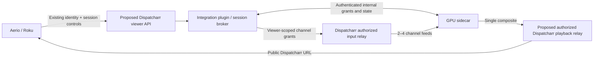

# Interactive multiview: Dispatcharr plugin and GPU sidecar research

Research bead: `AerioTV-Roku-cba.1`, parent `AerioTV-Roku-cba`.
Date: 2026-09-26 UTC. Status: research complete; PO authorized backlog creation
from these findings. Delivery and unresolved decisions are tracked in
`AerioTV-Roku-cba.2` through `AerioTV-Roku-cba.30`.

## Conclusion

**The building blocks exist, but no inspected off-the-shelf combination meets
the complete requirement.** A Dispatcharr integration plugin plus a GPU sidecar
is feasible as a direction. The important missing pieces are a viewer-facing
API, private session authorization, and a media engine that changes inputs,
geometry and selected audio without restarting the entire viewing experience.

The smallest supported integration direction is a narrow Dispatcharr extension
for authenticated viewer/session operations and media relay, a lightweight
plugin for sidecar configuration/lifecycle, and a separate media container.
Upstream acceptance of that extension is not established. A plugin-hosted HTTP
service routed through the existing external reverse proxy is another feasible
direction, but adds deployment routing and must implement viewer authorization
itself. Neither is an existing complete solution.

**Correction to the initial discussion:** the existing Multiview README says
hardware encoding is forthcoming, but its inspected `v0.4.3` source already has
NVENC, QSV and VAAPI encoder command builders. Decode, scaling and composition
are still CPU-side. Hardware code presence is not hardware validation.

No software was implemented, service deployed, provider setting changed, or
live stream opened for this research. No hardware performance or Roku multiview
PASS is claimed. PO subsequently authorized the delivery backlog; that does not
resolve the explicit product/upstream decisions identified below.

## Evidence and reproducibility

The following immutable source revisions were inspected in temporary clones:

| Source | Revision | Evidence boundary |
|---|---|---|
| Dispatcharr `v0.31.0` | `bcbb68c4f054ee56383a41604cfcd7302b85da66` | Repository documents identify this as the deployed version; deployment was not re-queried. |
| Dispatcharr `main` | `e3b482c36be69b5b9778338b239d6c0dcc08d643` | Relevant plugin, account, output, proxy, root routing and channel-query files have no diff from the above tag. |
| Existing Multiview `main` and `v0.4.3` | `8e588c67d52ba3c62afffcabfe9112d583647921` | Both resolved to this commit. Source inspected, not an installed instance or release ZIP. |
| Dispatcharr Plugins registry | `89092f0390e4901115aea70c5457f7930fde96e2` | Multiview manifest lists version 0.4.3, MIT, minimum Dispatcharr v0.27.0. |
| FFmpeg `master` | `8864fd0aecf21fe9e3cfcd83a8ef33cb7e885fd4` | Filter source and documentation evidence; not a selected production build. |

References below distinguish **source-established behavior**, **documentation
claims**, and **proposed behavior requiring implementation/measurement**.
The existing plugin's source manifest still says 0.1.0; the registry and release
tag identify 0.4.3. Use commit IDs when reproducing this investigation.

## Requirements-to-capabilities matrix

| Requirement | Available evidence | Gap / disposition |
|---|---|---|
| Composed playback through Dispatcharr | Existing plugin generates internal MPEG-TS source URLs and imports an M3U account. | Proven integration pattern in source, not a private per-viewer service. |
| Remote controls on existing endpoint | Core has plugin actions, but POST requires admin. Existing plugin runs its own HTTP server. | Needs viewer endpoint extension or external reverse-proxy routing. |
| Reuse API account | API-key authentication maps a key to an active user. | Add session grants and consistently enforce the user's channel/profile scope. |
| Reuse XC account | XC credentials map to a Dispatcharr user through `custom_properties.xc_password`. | Add XC-to-session authentication; XC password is not the dashboard password. |
| Reuse M3U connection | XC-generated M3U has an account; plain `/output/m3u` can be anonymous. | Anonymous playlist access cannot prove a viewer identity. Product decision required. |
| 2–4 panels, presets, ratios | Existing plugin has grid/featured/custom geometry; FFmpeg has hardware composition filters. | Dynamic per-session geometry and ratio application need new control/media logic. |
| Switch channel per panel | Existing worker accepts reconnect commands for existing inputs. | Reconnect is not reassignment; live channel replacement is missing. |
| Audio follows focus | Existing plugin selects audio at worker creation, or emits multiple tracks. | Add live single-output audio selection and measure audible response. |
| Intel VAAPI/QSV, NVIDIA, AMD VAAPI | Encoder builders exist; FFmpeg exposes relevant hardware APIs/filters. | Validate each device/driver path separately, including decode and composition. |
| Minimal Docker service | Separate worker architecture is already demonstrated by the plugin. | Extract/rebuild media runtime, package dependencies, bound resources. |
| Automatic credentials, host/port setup | Plugin has internal application access and persisted settings. | No inspected automatic service enrollment protocol; initial trust needs a deployment mechanism. |
| Other viewers unaffected | Live proxy shares source channels and tracks clients. | Private composites, non-destructive admission, ownership and teardown need explicit implementation. |

## 1. Dispatcharr plugin and API integration

### Source-established behavior

- Plugins are trusted server-side Python with internal model/task access.
  The documented interface offers fields, actions, `run` and optional `stop`.
  Heavy work should be outside the web request/worker [D1].
- `PluginAuthMixin` uses method-based permissions. POST requires `IsAdmin`,
  including `/api/plugins/plugins/<key>/run/` [D2, D3].
- `run_action(key, action_id, params)` builds context containing settings,
  logger and actions. It does not supply the request or authenticated user [D4].
- Inspected root/plugin routing and loader code provide no documented dynamic
  viewer-route registration hook [D4, D5]. This does not mean Python cannot
  mutate routing; doing so would be an unsupported integration technique.
- Reload/disable invokes stop hooks, but normal lifecycle hooks cannot guarantee
  cleanup after a process crash. Multiple application workers make an in-memory
  dictionary unsuitable as the only authoritative session registry.

### Feasible integration choices

| Approach | Assessment |
|---|---|
| Use ordinary plugin actions for every Aerio command | Fails the non-admin viewer requirement and lacks trusted caller context. Do not loosen all plugin actions to viewer access. |
| Add a narrow viewer API/session extension to Dispatcharr | Recommended supported direction: explicit account resolution, session ownership, channel authorization, resource admission and media relay. Plugin remains the integration/configuration surface. Requires upstream changes or a maintained downstream patch until accepted. |
| Plugin-hosted listener behind an external reverse-proxy path | Existing plugin demonstrates a separate listener. Can keep one public host/port while routing controls internally. Requires operator routing, its own correctly scoped auth adapter, and a private playback integration; not host/port-only setup in stock Dispatcharr. |
| Runtime monkey-patching of URLs/permissions | Technically possible in trusted Python; not recommended because worker reloads, upgrades and authorization behavior become fragile. |

An extension should expose only multiview capabilities and sessions, not
administrative plugin settings or arbitrary plugin actions. Protocol version,
panel state revision and account ownership must be checked at this boundary.
Endpoint names and implementation language remain undecided.

## 2. Existing Multiview plugin: reuse and limitations

Source at the pinned release establishes the following [M1–M6]:

- `_generate_m3u` writes loopback `/stream/<layout-id>` sources and creates or
  updates a shared `Dispatcharr Multiview` M3U account.
- Its server restricts source/composite routes to loopback. A separate optional
  dashboard runs on the plugin port; a configurable dashboard path does not
  mount that server under Dispatcharr's main HTTP port.
- Each composite request starts a standalone Python worker. Each source has a
  PyAV decode thread; numpy assembles YUV frames; FFmpeg encodes and muxes TS.
- `parameters.py` selects `h264_nvenc`, `h264_qsv`, `h264_vaapi`, or `libx264`.
  VAAPI/QSV paths upload software frames. Availability checking searches
  `ffmpeg -encoders`; it does not open a GPU or run a composition probe.
- Worker stdin supports `reconnect_channel` and `reconnect_all`. It has no
  command to change channel URL, geometry, or the active audio selection.
- Dashboard settings are shared `PluginConfig` state. Reload kills affected
  workers and clients must recover. It is not an independent viewer-session API.
- Audio choices are fixed at startup: one selected source or one AC3 track per
  tile. The latter is not our single selected audio stream contract.
- Per-input queues, PTS pacing, stale-input placeholders, reconnect/backoff and
  cleanup are valuable reference implementations.

### Authorization implications for reuse

The internal proxy adapter registers input clients and generators with
`user=None`, and resolves channels without a viewer-scoped permission check
[M5]. This cannot be reused as the authorization boundary for private sessions.

The dashboard token checker constructs `AccessToken(token)` and returns a
boolean. The inspected handlers do not resolve a live user or check admin,
session ownership, or permitted channel profiles. Channel enumeration queries
the global channel table and settings updates affect the global configuration
[M6]. These are specific source findings, not a runtime exploit test. Reusing
this dashboard as a viewer API would fail our ownership requirements.

**Reuse recommendation:** retain lessons and potentially isolated geometry,
clocking, reconnect and encoder-building code, subject to tests and attribution.
Do not base viewer authorization or private state on the existing dashboard.
Evaluate collaboration with the maintainer before a fork; no contact has been
made. MIT is declared in both manifests; preserve applicable notices and verify
the redistributed artifact's license/dependency contents before copying code.

Packaging is also relevant: `deps.py` downloads a pinned CPython 3.13 PyAV wheel
at runtime; its comments estimate about 114 MB per architecture [M7]. That is a
source estimate, not a measured container size. A sidecar should have its media
dependencies baked into a reproducible image rather than inherit plugin-host
Python and download them on first playback.

## 3. Account identity, automatic setup and credentials

### API accounts

Dispatcharr API-key auth accepts `X-API-Key` or `Authorization: ApiKey`, resolves
the user and rejects inactive users [D6]. Aerio already uses verified API account
and profile state. The proposed viewer endpoint can reuse that identity and
issue short-lived session/control/playback grants. The sidecar should receive
scoped internal grants, not the user's reusable API key or provider passwords.

Channel summary applies level, profile membership, visibility and optional adult
filtering [D7]. Apply the active Aerio profile as an additional narrowing scope;
do not trust arbitrary channel IDs or assume an internal model query inherits
the authenticated lineup's rules.

### XC accounts and account-bearing M3U

`xc_get_user` and `stream_xc` resolve username plus the separate XC password,
and apply surface-specific network restrictions. `stream_xc` filters channels
by user level and assigned enabled profiles before calling the live proxy [D8,
D9]. XC credentials therefore can establish identity without API/admin access.

Proposed flow: submit the already-configured XC credentials to an authenticated
exchange on the same trusted Dispatcharr origin; verify current user status,
network policy and entitlements; return a session-scoped grant. A playlist from
`get.php` can use that same mechanism if its credentials are available to Aerio.
Do not treat an unknown `player_api.php?action=...` as a plugin extension:
unknown actions currently return account info [D8].

### Anonymous M3U is a real requirement gap

Plain `m3u_endpoint` is network-gated and can call `generate_m3u` with `user=None`.
A named profile can select channels without authenticating a person [D8].
Possession of that URL does not establish the account needed for private sessions.

Choices for PO review are:
- Account-bearing Dispatcharr M3U/XC for multiview; or
- An explicit installation policy that exchanges permitted anonymous playlist
  access for a device-scoped guest capability, with defined lineup/quotas; or
- A new account-bound playlist token/bootstrap mechanism in Dispatcharr.

The second and third choices require new functionality. Do not silently grant
anonymous playlists administrator authority or promise zero-input account
pairing from an identity-free URL.

Aerio's documented current credential policy also rejects query-bearing saved
playlist URLs and keeps XC passwords session-only [A1]. Supporting account-bound
playlist bootstrap may require a credential-policy/client change. Per-session
multiview grants must not silently turn into persisted XC credentials.

### Automatic plugin–sidecar enrollment

No inspected component provides this protocol. Recommended same-host deployment
candidate: a narrowly shared bootstrap secret/identity volume, generated by the
deployment and consumed by plugin and sidecar, followed by authenticated
challenge/response and scoped key issuance. This avoids typing/copying a key.
It adds a deployment mount, not a viewer prompt, and needs a designed rotation
and reset procedure. Never share the whole Dispatcharr data directory or Docker
socket merely to provision keys.

Host/IP and port identify a destination, not its authenticity. Without a shared
deployment trust anchor or an already trusted certificate, completely unattended
pairing is trust-on-first-use, not verified mutual identity. That tradeoff must
be explicit. External Aerio traffic should use the already trusted Dispatcharr
HTTPS origin; service key changes must not be silently accepted as reconnects.

Revalidate ownership/permissions at mutations, playback authorization and lease
renewal. Revocation/account changes terminate owned sessions and input grants;
no credentials in FFmpeg arguments, logs or returned upstream URLs. Scoped
grants and server-side resolution also avoid forwarding API headers to providers.

## 4. Private playback through Dispatcharr

The existing plugin proves a static composite can be an input to Dispatcharr.
It does not prove private viewer composites are safe as ordinary channels.

`stream_ts` is `AllowAny`, checks the STREAMS network surface, accepts an optional
user, and uses a channel UUID. It is not itself a session-owner check [D9].
Hiding a channel from a lineup or choosing an unguessable UUID is not equivalent
to authorizing playback. A reverse-proxy rule for controls alone does not solve
private playback through this route.

Recommended candidate: a dedicated Dispatcharr session playback endpoint that
checks a bounded playback grant and relays the sidecar's internal output.
Reuse appropriate proxy internals only behind explicit authorization; avoid
creating one persistent global channel/profile per viewer session. The actual
extension and its integration with stats still require implementation.

Keep the following properties explicit:
- Input requests resolve approved channel IDs inside Dispatcharr; no arbitrary
  provider URLs from a control request. Never choose a composite as an input.
- Per-session output identity prevents unrelated viewers from sharing a mutable
  composite. Source-channel sharing may remain possible after authorization.
- Relay bytes rather than redirecting the Roku to the internal sidecar.
- TS is the leading transport candidate because both the existing plugin and
  Aerio have a TS path. Propose H.264 plus one AAC audio stream for compatibility;
  existing-plugin AC3 is not acceptance evidence for this output.
- If HLS is selected, every playlist/segment/key URI must remain on the authorized
  public surface. HLS introduces segment/player delay that affects audio focus.
- Avoid an unnecessary second video encode in Dispatcharr. Output profiles and
  stream-profile redirects must be considered explicitly.
- A stable URL alone does not preserve decoder continuity. Timestamps, keyframes,
  codec parameters, mux state and buffers must also remain valid across updates.

## 5. GPU and live-reconfiguration feasibility

### Available building blocks

FFmpeg source documents VAAPI and QSV custom-layout stacking with per-input output
sizes; NVIDIA can use CUDA scaling/padding/overlay with NVDEC/NVENC [F1–F4].
These are capabilities to test, not proof that every GPU/driver combination works.

| Backend | Candidate video path | Runtime needs / principal uncertainty |
|---|---|---|
| Intel VAAPI | VAAPI decode → scale/`xstack_vaapi` → `h264_vaapi` | Render node, libva and suitable Intel media driver. Matching hardware contexts/formats; codec generation and VPP support. |
| Intel QSV | QSV decode/VPP → `xstack_qsv` → `h264_qsv` | Render node, compatible Intel driver and VPL/runtime. Separate validation from VAAPI even on the same iGPU. |
| NVIDIA | NVDEC/CUDA frames → CUDA scale/pad/overlay chain → `h264_nvenc` | Compatible host driver and NVIDIA container runtime; expose video/compute capabilities. Codec and concurrent-engine capacity vary by GPU. |
| AMD VAAPI | VAAPI decode → supported VAAPI processing → `h264_vaapi` | Render node and Mesa VAAPI driver. Multi-input VPP/stacking support must be probed; Intel success does not establish AMD support. |

The VAAPI stack implementation requires hardware frames on the same underlying
device and matching underlying software pixel formats [F2]. Normalize geometry,
SAR, frame cadence and color representation. Mixed SDR/HDR, interlacing, 10-bit
sources and codec changes need explicit input policy and tests.

Mesa documentation establishes AMD/VAAPI availability generally [H3]; a fetch of
its detailed VA frontend source was blocked by the site's browser challenge.
No specific AMD multi-input VPP support is claimed here. CPU composition between
hardware decode and encode is a possible compatibility path, with transfer and
CPU costs exposed; acceptance of that hybrid path is a product decision.

The existing plugin provides a simpler CPU-decode/CPU-compose/GPU-encode path
already in source. It is useful for comparison, but cannot be described as
end-to-end GPU acceleration. Its encoder-list probe must be replaced/supplemented
with a real short encode/composition check on the selected device.

### Audio is easier to change than graph topology, but still buffered

FFmpeg `astreamselect` supports a runtime `map` command. `azmq` can deliver
commands to filters when built with libzmq [F5]. This establishes a possible
single-audio-output switch, not a complete control API. Any worker command
socket stays internal behind authenticated sidecar control.

Decode/resample each panel's audio into bounded, timestamp-aligned buffers, then
select one stream for a continuous audio encoder. Substitute silence for a panel
without audio. Merely changing an encoder's `-map` argument is not a live switch.
The plugin currently only decodes selected startup audio, so this is new work.

Focus changes have an unavoidable downstream-delay component: queued audio in
the encoder, Dispatcharr and Roku cannot be retroactively changed. Measure
remote keypress-to-audible-switch latency, not just HTTP response time. Keep
desired, media-applied and client-visible state distinct; debounce obsolete
focus commands without losing the final selection.

### Layout and channel changes are the hardest media gap

The inspected VAAPI/QSV stack option definitions and filter registration have no
runtime layout command handler [F3]. A filter marked with dynamic inputs does
not mean an arbitrary new network URL can be hot-added to a running FFmpeg CLI.
The existing plugin's worker control likewise only reconnects existing inputs.

Candidate implementation approaches, requiring later experiments:

| Approach | Tradeoff |
|---|---|
| Restart one FFmpeg graph on channel/layout changes | Simplest, but output interruption, timestamp reset and Roku rebuffering are likely. Not sufficient for seamless focus-following audio. |
| Independent supervised inputs + persistent compositor/encoder | Better failure isolation and channel replacement. Needs clocked fallback frames, bounded queues and controllable media code; hardware-frame sharing across processes is non-trivial. |
| Programmatic libav media engine with persistent output | Can keep demux/decode inputs, geometry and audio selection separate from encoder/mux lifetime. More implementation effort and backend-specific integration than a CLI wrapper. |

Recommendation: require persistent output for audio changes; investigate
programmatic/supervised media boundaries for channel and layout changes. Do not
promise that adding a REST wrapper around the existing FFmpeg command delivers
the full experience. Do not concatenate restarted TS byte streams and assume
continuity. A full replacement graph can temporarily double decode/provider
load unless inputs are shared; reserve that capacity or avoid the overlap.

### Minimal container

One sidecar API/supervisor and media workers are sufficient initially. A new
database, message broker or orchestration platform is not justified. Use a
bounded local state/identity volume and ephemeral media buffers. Shared session
authority across Dispatcharr workers can use its existing durable/cache services,
but must be explicit rather than duplicated unsynchronized state.

Intel and AMD use `/dev/dri` access with matching user-mode libraries. NVIDIA
needs host/runtime device integration and `video` capability in addition to CUDA
compute; the default compute/utility capabilities alone are insufficient [H4].
Keep build toolchains out of runtime images. Image variants are reasonable if
driver dependencies make one image excessively large; no image size is measured.
Select a redistributable FFmpeg build deliberately: do not blindly copy NVIDIA's
example configuration using `--enable-nonfree`/libnpp into a public image. CUDA
filter alternatives exist, and the final build's license must be checked [H2].

## 6. Resource accounting and unaffected viewers

Dispatcharr counts either connections or distinct channels depending on its
user-limit settings. On reaching the limit, it may attempt to terminate an
existing connection rather than reject the new one [D10]. Opening four ordinary
input requests blindly can therefore interrupt another device's playback.

The current Multiview adapter avoids user accounting with `user=None`; that is
not an acceptable substitute for admission policy. Separate these budgets:
- Provider/upstream slots: usually up to N distinct feeds for N panels, possibly
  fewer if an authorized proxy source is already shared; never assume sharing.
- Viewer input entitlement: define whether multiview consumes N permitted input
  slots, and how those relate to Dispatcharr's existing user limit.
- Composite playback: one output client, not an accidental N+1 charge under an
  unexamined policy. Output-client accounting must remain observable.
- Host: N decoders, one compositor, one video encoder and selected audio output
  per independent session; additional resources during replacement/recovery.

Recommended admission is reserve-or-reject, not evict another viewer. Acquire
budgets atomically and roll back partially opened inputs on failure. Preserve
existing source sessions on shared channels; stopping a composite removes its
owned clients, not the entire shared channel.

Sizing illustration only: four 8 Mb/s inputs and one 8 Mb/s output mean about
32 Mb/s upstream media and 8 Mb/s WAN egress before overhead, with additional
internal Dispatcharr↔sidecar traffic. One 1920×1080 8-bit YUV420 frame is about
3.11 MB; at 60 fps one full-frame copy is about 187 MB/s. Multiple queues,
surfaces, copies and decoders multiply memory demand. These arithmetic examples
are not measured host budgets or recommended defaults.

Use lease expiry, input timeouts, stop/Back cleanup, account-switch revocation,
plugin disable/reload handling and sidecar restart reconciliation. Network loss
must expire sessions even when no explicit Stop arrives. Cleanup must cover
worker process trees, GPU surfaces, proxy clients, tokens, temporary output and
any reservations. Logs should record session/revision/backend and per-stage
latency without credentials or playable input URLs.

## 7. Concrete validation work needed after review

No entry in this table was executed during this source-research task.

| Experiment | Evidence required to accept a path |
|---|---|
| Viewer integration | API, XC and the agreed M3U identity mode create/control private sessions without admin permissions. Test stale/foreign session IDs, revoked users, narrowed profiles and disabled plugin. |
| Remote endpoint | A client outside the LAN reaches controls and media through the existing Dispatcharr public endpoint. No sidecar route, private URL, redirect or HLS subresource leaks. |
| Hardware matrix | On representative Intel VAAPI, Intel QSV, NVIDIA and AMD VAAPI hosts, record model, driver, FFmpeg build/configuration, successful decode/compose/encode stages and all CPU fallbacks. |
| Media matrix | Two, three and four distinct authorized moving inputs; mixed frame rates, audio absent, reconnect, source codec/size changes and unsupported input policy. Record output FPS, dropped frames, CPU, RSS, GPU/VRAM and bitrate. |
| Focus audio | Repeat focus changes with identifiable source audio; measure median/p95 keypress-to-audible-change, confirm one audible source and no persistent A/V drift. API acknowledgement alone is insufficient. |
| Channel/layout mutation | Repeated panel changes and preset/ratio updates; record interruption duration, timestamp continuity, decoder errors and temporary input/encoder peaks. Coalesce stale revisions. |
| Isolation | Stall one input while others keep moving; two viewers with different channels/audio; one viewer exits without affecting the other; limit exhaustion rejects without terminating an existing stream. |
| Lifecycle | Back/Stop, WAN drop, app crash, account switch, grant expiry, plugin reload and sidecar crash. Verify counts/resources return to baseline within a declared cleanup bound. |
| Roku acceptance | Target 3820RW2, real TV picture/audio confirmation, focus/Back behavior and fallback to normal Live TV. Compare TS first; test HLS only if needed. |

Before live tests, record baseline resources and agree measurable startup,
mutation/audio-latency, cleanup and other-viewer-impact thresholds. Source
inspection cannot honestly supply a universal numeric latency/capacity promise.
Use bounded synthetic/recorded media first, then authorized live inputs on the
host and finally the actual Roku/WAN path. Runtime probes are future work, not
implicitly authorized deployment by this report.

## 8. Decisions required before further planning

1. **Integration:** pursue the narrow upstream Dispatcharr viewer/session/relay
   extension, or accept an externally routed plugin listener and its deployment
   configuration? Recommendation: upstream extension; upstream willingness is
   unknown and no issue/PR has been opened.
2. **M3U identity:** require account-bearing playlists for private multiview, or
   explicitly add guest/device capability enrollment? Recommendation: keep
   account-bearing identity as the first supported path; anonymous support needs
   a separate agreed product rule, not silent omission.
3. **Acceleration:** is a reported, budgeted CPU-composition path acceptable when
   hardware decode/encode work but a GPU lacks usable multi-input processing?
   All four requested backends remain requirements until the PO decides otherwise.

The existing scope (2–4 panels, presets/ratios, focus-following audio, Dispatcharr
playback) remains the product target. Following PO authorization, the research
bead was closed and the implementation/decision backlog was created under `cba`.
The decisions above remain explicit prerequisites in that backlog.

## Source references

- [D1 — Plugin contract](https://github.com/Dispatcharr/Dispatcharr/blob/e3b482c36be69b5b9778338b239d6c0dcc08d643/Plugins.md)
- [D2 — Plugin API views](https://github.com/Dispatcharr/Dispatcharr/blob/e3b482c36be69b5b9778338b239d6c0dcc08d643/apps/plugins/api_views.py#L95-L106)
- [D3 — Method permissions](https://github.com/Dispatcharr/Dispatcharr/blob/e3b482c36be69b5b9778338b239d6c0dcc08d643/apps/accounts/permissions.py)
- [D4 — Plugin loader and context](https://github.com/Dispatcharr/Dispatcharr/blob/e3b482c36be69b5b9778338b239d6c0dcc08d643/apps/plugins/loader.py#L541-L574)
- [D5 — Root routing](https://github.com/Dispatcharr/Dispatcharr/blob/e3b482c36be69b5b9778338b239d6c0dcc08d643/dispatcharr/urls.py), [plugin routing](https://github.com/Dispatcharr/Dispatcharr/blob/e3b482c36be69b5b9778338b239d6c0dcc08d643/apps/plugins/api_urls.py)
- [D6 — API-key authentication](https://github.com/Dispatcharr/Dispatcharr/blob/e3b482c36be69b5b9778338b239d6c0dcc08d643/apps/accounts/authentication.py#L46-L88)
- [D7 — Channel query authorization](https://github.com/Dispatcharr/Dispatcharr/blob/e3b482c36be69b5b9778338b239d6c0dcc08d643/apps/channels/api_views.py#L1095-L1136)
- [D8 — M3U and XC output/authentication](https://github.com/Dispatcharr/Dispatcharr/blob/e3b482c36be69b5b9778338b239d6c0dcc08d643/apps/output/views.py)
- [D9 — Live proxy and XC playback](https://github.com/Dispatcharr/Dispatcharr/blob/e3b482c36be69b5b9778338b239d6c0dcc08d643/apps/proxy/live_proxy/views.py)
- [D10 — User stream limits](https://github.com/Dispatcharr/Dispatcharr/blob/e3b482c36be69b5b9778338b239d6c0dcc08d643/apps/proxy/utils.py#L304-L370)
- [M1 — Multiview lifecycle/import](https://github.com/swvn-dispatch/dispatcharr-multiview/blob/8e588c67d52ba3c62afffcabfe9112d583647921/src/__init__.py)
- [M2 — Server, worker configuration and commands](https://github.com/swvn-dispatch/dispatcharr-multiview/blob/8e588c67d52ba3c62afffcabfe9112d583647921/src/server.py)
- [M3 — Encoder builders](https://github.com/swvn-dispatch/dispatcharr-multiview/blob/8e588c67d52ba3c62afffcabfe9112d583647921/src/parameters.py)
- [M4 — Composition and control](https://github.com/swvn-dispatch/dispatcharr-multiview/blob/8e588c67d52ba3c62afffcabfe9112d583647921/src/compositor_worker.py), [input decode/clocking](https://github.com/swvn-dispatch/dispatcharr-multiview/blob/8e588c67d52ba3c62afffcabfe9112d583647921/src/channel.py)
- [M5 — Internal proxy adapter](https://github.com/swvn-dispatch/dispatcharr-multiview/blob/8e588c67d52ba3c62afffcabfe9112d583647921/src/dispatcharr.py)
- [M6 — Dashboard authentication and shared settings](https://github.com/swvn-dispatch/dispatcharr-multiview/blob/8e588c67d52ba3c62afffcabfe9112d583647921/src/dash/api.py#L57-L261)
- [M7 — Runtime media dependencies](https://github.com/swvn-dispatch/dispatcharr-multiview/blob/8e588c67d52ba3c62afffcabfe9112d583647921/src/deps.py)
- [M8 — Registry manifest](https://github.com/Dispatcharr/Plugins/blob/89092f0390e4901115aea70c5457f7930fde96e2/plugins/multiview/plugin.json), [distribution rules](https://github.com/Dispatcharr/Plugins/blob/89092f0390e4901115aea70c5457f7930fde96e2/CONTRIBUTING.md)
- [F1 — FFmpeg VAAPI/QSV stack and CUDA filter documentation](https://github.com/FFmpeg/FFmpeg/blob/8864fd0aecf21fe9e3cfcd83a8ef33cb7e885fd4/doc/filters.texi)
- [F2 — VAAPI stack hardware constraints](https://github.com/FFmpeg/FFmpeg/blob/8864fd0aecf21fe9e3cfcd83a8ef33cb7e885fd4/libavfilter/vf_stack_vaapi.c#L133-L190)
- [F3 — Stack options/registration](https://github.com/FFmpeg/FFmpeg/blob/8864fd0aecf21fe9e3cfcd83a8ef33cb7e885fd4/libavfilter/stack_internal.c#L310-L357)
- [F4 — QSV stack implementation](https://github.com/FFmpeg/FFmpeg/blob/8864fd0aecf21fe9e3cfcd83a8ef33cb7e885fd4/libavfilter/vf_stack_qsv.c)
- [F5 — Stream selection runtime commands](https://github.com/FFmpeg/FFmpeg/blob/8864fd0aecf21fe9e3cfcd83a8ef33cb7e885fd4/libavfilter/f_streamselect.c), `astreamselect`/`azmq` sections in F1
- [H1 — Intel media driver capabilities](https://github.com/intel/media-driver), [Intel VPL specification 2.17 documentation](https://intel.github.io/libvpl/latest/) (retrieved 2026-09-26; documentation, not device tests)
- [H2 — NVIDIA Video Codec SDK 13.0 FFmpeg guidance](https://docs.nvidia.com/video-technologies/video-codec-sdk/13.0/ffmpeg-with-nvidia-gpu/index.html)
- [H3 — Mesa supported platforms/APIs](https://docs.mesa3d.org/systems.html) (retrieved 2026-09-26)
- [H4 — NVIDIA container device/driver capabilities](https://docs.nvidia.com/datacenter/cloud-native/container-toolkit/latest/docker-specialized.html) (retrieved 2026-09-26)
- A1 — [Aerio credential policy](CONNECTION-CREDENTIAL-POLICY.md), [provider contract](MEDIA-PROVIDER-CONTRACT.md), `components/DispatcharrTask.brs`, `components/ConnectionNavigation.brs`, `components/AerioScene.brs`, `source/M3uModel.brs`.
